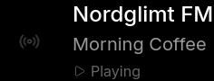

# mirrordash-radio

Internet radio through the mirror's speakers: Sveriges Radio and some 50 000 stations worldwide, with
what's on now.



The card shows the station, what's on (the programme on Sveriges Radio, the song on stations that send it)
and whether it plays. It stands still between updates.

Needs MirrorDash 0.12 and the OS image that came with it or later (modules may play sound from it on). The
sound goes to the **3.5 mm jack** (powered speakers or headphones) or, if the screen has speakers, over
**HDMI**.

## Stations

Under **Stations**, add one line per station:

- **A name**, such as `Sveriges Radio P1`, `Sveriges Radio P4 Göteborg` or `Mix Megapol`. The module looks
  it up in [Radio Browser](https://www.radio-browser.info), an open list of stations, and plays the most
  played match in its best sound. Give the whole name: `P1` alone could be Denmark's.
- **A stream's address** (`https://…`), if the station isn't found or you want a particular stream.

A double press on the mirror's button steps through them in this order.

## Playing and stopping

The mirror has no touch screen, so the radio is controlled from elsewhere:

- **Play When Shown**: plays as soon as the mirror starts. With the module's **schedule** (its settings,
  under *Schedule*), that's an alarm-clock radio: weekdays 06:30–08:00, say.
- **The mirror's button**: choose it under **Button**. One press plays or stops, two go to the next station.
  Set that button's own actions to nothing in the Hardware tab, or both happen.
- **Home Assistant** (Admin → Settings → MQTT, share the module and allow control): *Playing* (a switch),
  *Next station*, *Volume*, *Play address* (any stream's address), and *Station* and *Now playing* to read.
- **A phone shortcut**: below.

The radio is silent while its card isn't on the screen: the screen off, the module's schedule outside its
times, or privacy mode (unless the module is marked *Shown in Privacy Mode*). It plays again when the card
comes back, if it played before. The station and whether it plays outlast a restart.

## A phone shortcut (optional)

Set a **Token** in the module's settings. Then a shortcut on your phone (iOS Shortcuts, Android's HTTP
Shortcuts) can control the radio on your home network:

```bash
curl -X POST http://mirrordash.local/api/modules/<instance>/play -H "X-Token: <your token>"
curl -X POST http://mirrordash.local/api/modules/<instance>/play -H "X-Token: <your token>" \
     -H "Content-Type: application/json" -d '{"url": "https://live1.sr.se/p3-mp3-96"}'
curl -X POST http://mirrordash.local/api/modules/<instance>/stop -H "X-Token: <your token>"
```

`<instance>` is `mirrordash_radio` for the first radio you add, `mirrordash_radio-2` for a second. Without a
token set, nobody can.

## Settings

| Setting | What it does |
| :--- | :--- |
| Stations | Names to look up, or stream addresses. |
| Volume | 0–100, as it sounds. *System Volume* in the Hardware tab is the whole mirror's. |
| Speakers | The 3.5 mm jack, or the screen over HDMI. A screen without speakers stays silent, without an error. |
| Play When Shown | Play from the start. |
| Button | The mirror's button that plays, stops and steps. |
| Show Logo | The station's logo, small and gray. |
| Token | For a phone shortcut. |

## Develop

```bash
uv run pytest                    # the module's tests
uvx mirrordash-sdk validate .    # checks the module before you push it
```
